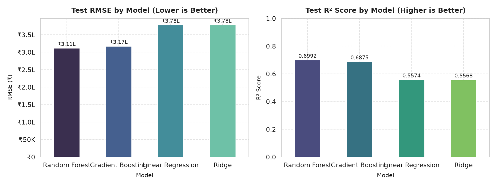
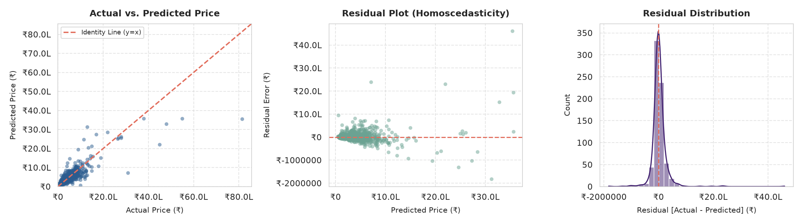
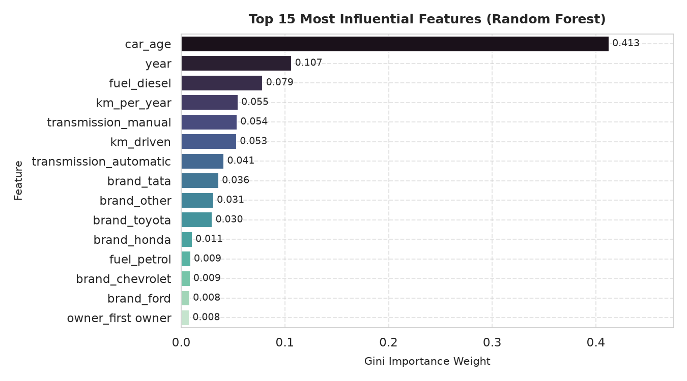
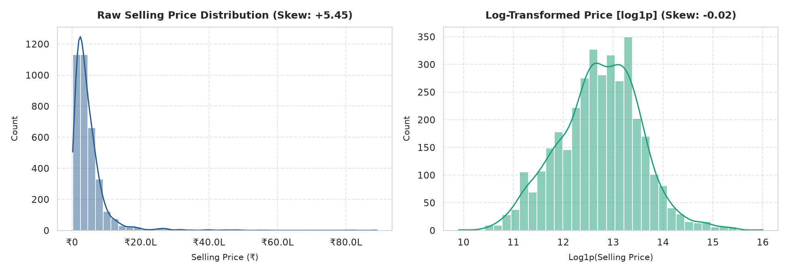
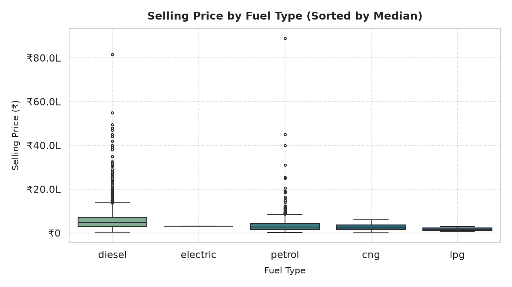
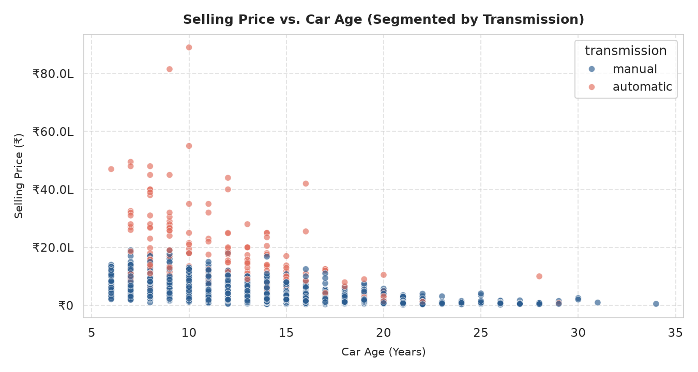
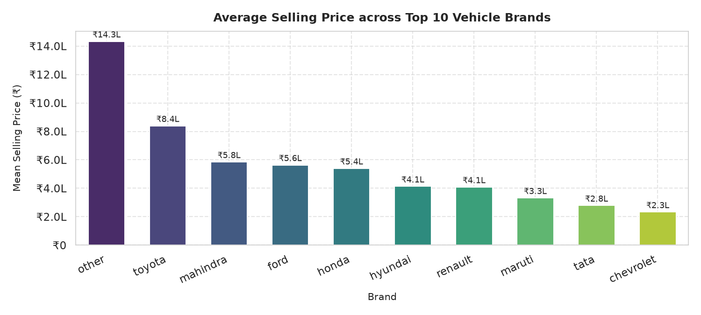

# 🚗 Used Car Price Prediction: Production-Grade ML Pipeline

[](https://www.python.org/)
[](https://scikit-learn.org/)
[](https://pandas.pydata.org/)
[](https://opensource.org/licenses/MIT)
[](car_price_prediction.ipynb)

An end-to-end, production-grade regression machine learning system predicting secondary market automotive valuations using the Kaggle **Vehicle dataset from CarDekho**. Built with strict production ML principles: leak-free `ColumnTransformer` pipelines, logarithmic target scaling (`TransformedTargetRegressor`), multi-model cross-validation benchmarking, hyperparameter optimization, residual calibration diagnostics, and mathematical formula sheets.

---

## 1. Project Overview & Architecture

Used car price estimation features severe non-linear price degradation, heavy positive skewness, and complex multi-way interactions between brand reputation, vehicle chronological age, fuel powertrain, and usage intensity.

```
Raw CSV ──► Data Hygiene ──► Dynamic Feature Eng. ──► ColumnTransformer ──► TransformedTargetRegressor ──► Model Selection & Diagnostics
```

- **Data Hygiene**: Automated column header standardization, whitespace trimming, lowercase conversion, deduplication (763 duplicate listings removed), and impossible-value validation.
- **Dynamic Feature Engineering**: Derives `car_age` from system calendar year (`datetime.now().year - year`), extracts and standardizes `brand` (grouping $<1\%$ share into `'other'`), and computes annual usage intensity `km_per_year`.
- **Target Normalization**: Models target on $\log(1 + \text{selling\_price})$ to compress raw skewness from **+5.45** to **-0.02**, stabilizing squared-error loss gradients and mitigating extreme luxury outlier leverage.
- **Leak-Free Pipelines**: Strict encapsulation of `OneHotEncoder(handle_unknown='ignore')` and numeric transformers within scikit-learn `Pipeline` objects fit strictly on training splits.

---

## 2. Project Directory Structure

```text
Car-Price-Prediction/
├── assets/                          # High-resolution visual figures and diagnostic plots
│   ├── best_model_diagnostics.png   # Calibration scatter, residual plot, error histogram
│   ├── feature_importance.png       # Top 15 Gini importance feature weights
│   ├── model_benchmark_comparison.png # Test RMSE and R² bar charts
│   ├── price_distribution.png       # Raw vs. Log-transformed price distributions
│   ├── price_vs_car_age.png         # Depreciation curve by transmission
│   ├── price_vs_fuel.png            # Fuel type pricing boxplots
│   └── top_10_brands.png            # Average selling price by top manufacturer
├── car_price_prediction.ipynb       # Fully executed end-to-end production notebook
├── data/
│   └── CAR DETAILS FROM CAR DEKHO.csv # Kaggle vehicle dataset
└── README.md                        # Production documentation and benchmark report
```

---

## 3. Dataset Information

- **Source**: [Kaggle - Vehicle Dataset from CarDekho (Nehal Birla)](https://www.kaggle.com/datasets/nehalbirla/vehicle-dataset-from-cardekho)
- **Dataset File**: `data/CAR DETAILS FROM CAR DEKHO.csv`
- **Raw Observations**: 4,340 listings, 8 features
- **Cleaned Records**: 3,577 deduplicated records
- **Primary Attributes**:
  - `name`: Vehicle make and model title
  - `year`: Manufacturing calendar year (1992 – 2020)
  - `selling_price`: Target sale price in Indian Rupees (₹20,000 – ₹8,900,000)
  - `km_driven`: Total odometer reading (1 – 806,599 km)
  - `fuel`: Powertrain type (`diesel`, `petrol`, `cng`, `lpg`, `electric`)
  - `seller_type`: Sales channel (`individual`, `dealer`, `trustmark dealer`)
  - `transmission`: Transmission gearbox (`manual`, `automatic`)
  - `owner`: Prior ownership title (`first owner`, `second owner`, etc.)

---

## 4. Mathematical Foundations & Statistical Formulations

This pipeline translates core theoretical principles into production modeling decisions:

### 4.1 Target & Distribution Transformations
- **Log1p & Expm1 Mapping:**
  $$\tilde{y} = \ln(1 + y) \qquad \longleftrightarrow \qquad \hat{y} = \exp(\hat{\tilde{y}}) - 1$$
- **Retransformation Bias (Jensen's Inequality):**
  $$\mathbb{E}[\exp(Z)] \ge \exp(\mathbb{E}[Z])$$
  Applying standard $\text{expm1}(\hat{\tilde{y}})$ yields the conditional median, not the mean. For log-normal errors, the **Cox correction** estimates conditional mean:
  $$\hat{y}_{\text{mean}} = \exp\!\left(\hat{\tilde{y}} + \tfrac{\hat{\sigma}^2}{2}\right) - 1, \qquad \hat{\sigma}^2 = \frac{1}{n-p}\sum_{i=1}^{n}\hat{e}_i^2$$
  Or non-parametrically via **Duan's Smearing Estimator**:
  $$\hat{y}_{\text{smear}} = \left[\frac{1}{n}\sum_{i=1}^{n}\exp(\hat{e}_i)\right]\cdot\exp(\hat{\tilde{y}}), \qquad \hat{e}_i = \tilde{y}_i - \hat{\tilde{y}}_i$$
- **Sample Skewness (Fisher-Pearson Coefficient):**
  $$g_1 = \frac{\frac{1}{n}\sum_{i=1}^{n}(x_i - \bar{x})^3}{\left[\frac{1}{n}\sum_{i=1}^{n}(x_i - \bar{x})^2\right]^{3/2}} \qquad \left(g_{1,\text{raw}} = +5.45 \;\longrightarrow\; g_{1,\log 1p} = -0.02\right)$$
- **Box-Cox ($y > 0$) & Yeo-Johnson Transformations:**
  $$y^{(\lambda)} = \begin{cases}\dfrac{y^{\lambda}-1}{\lambda} & \lambda \neq 0 \\[6pt] \ln y & \lambda = 0\end{cases}, \qquad \hat{\lambda} = \arg\max_{\lambda}\; -\frac{n}{2}\ln\hat{\sigma}^2_{\lambda} + (\lambda-1)\sum_{i=1}^{n}\ln y_i$$

### 4.2 Feature Engineering & Depreciation Dynamics
- **Car Age & Usage Wear Intensity:**
  $$\text{car\_age} = Y_{\text{current}} - Y_{\text{manufacture}}, \qquad \text{km\_per\_year} = \frac{\text{km\_driven}}{\max(\text{car\_age},\,1)}$$
- **Theoretical Depreciation Models:**
  - *Exponential Decay*: $V(t) = V_0\, e^{-kt} \;\implies\; \ln V(t) = \ln V_0 - kt$
  - *Constant Percentage Depreciation*: $V(t) = V_0\,(1-d)^{t} \;\implies\; \ln V(t) = \ln V_0 + t\ln(1-d)$
  Both models are intrinsically linear in time $t$ on the log scale, demonstrating why modeling $\ln(\text{price})$ is the natural mathematical fit.
- **Polynomial & Interaction Dynamics:**
  $$\ln y = \beta_0 + \beta_1 t + \beta_2 t^2 + \beta_3 m + \beta_4 (t \cdot m) + \varepsilon \qquad (t = \text{car\_age},\; m = \text{km\_driven})$$

### 4.3 Outlier Boundaries & Trimming
- **Tukey's IQR Fences:**
  $$\text{IQR} = Q_3 - Q_1, \qquad [\,Q_1 - 1.5\,\text{IQR},\; Q_3 + 1.5\,\text{IQR}\,]$$
- **Modified Z-Score via Median Absolute Deviation (MAD):**
  $$\text{MAD} = \text{median}_i\left(|x_i - \tilde{x}|\right), \qquad M_i = \frac{0.6745\,(x_i - \tilde{x})}{\text{MAD}} \quad (\text{flagged if } |M_i| > 3.5)$$
- **Log-Scale Fences (Preferred for Heavy Positive Skew):**
  $$[\,Q_1^{\ln} - 1.5\,\text{IQR}^{\ln},\; Q_3^{\ln} + 1.5\,\text{IQR}^{\ln}\,], \qquad \text{computed on } \ln(1+y)$$

### 4.4 Loss Functions & Regularization
- **Ordinary Least Squares (OLS):**
  $$\mathcal{L}_{\text{OLS}}(\beta) = \frac{1}{2n}\sum_{i=1}^{n}\left(y_i - x_i^{T}\beta\right)^2, \qquad \hat{\beta}_{\text{OLS}} = (X^{T}X)^{-1}X^{T}y$$
- **Ridge ($L_2$) Loss & Analytical Solution:**
  $$\mathcal{L}_{\text{Ridge}}(\beta) = \frac{1}{2n}\lVert y - X\beta\rVert_2^2 + \frac{\alpha}{2}\lVert\beta\rVert_2^2 \;\implies\; \hat{\beta} = \left(X^{T}X + n\alpha I\right)^{-1}X^{T}y$$
- **Log-Target Loss vs. Percentage Error Equivalence:**
  $$\ln\hat{y} - \ln y = \ln\!\left(1 + \frac{\hat{y}-y}{y}\right) \approx \frac{\hat{y}-y}{y} \;\implies\; \sum_{i=1}^n (\ln\hat{y}_i - \ln y_i)^2 \approx \sum_{i=1}^n \left(\frac{\hat{y}_i-y_i}{y_i}\right)^2$$
  Minimizing MSE in log-space inherently optimizes squared relative percentage error on original price.

### 4.5 Regression Evaluation Metrics
- **Root Mean Squared Error (RMSE):** $\text{RMSE} = \sqrt{\frac{1}{n}\sum_{i=1}^{n}(y_i-\hat{y}_i)^2}$
- **Mean Absolute Error (MAE):** $\text{MAE} = \frac{1}{n}\sum_{i=1}^{n}|y_i-\hat{y}_i|$
- **Coefficient of Determination ($R^2$) & Adjusted $R^2$:**
  $$R^2 = 1 - \frac{\sum_{i=1}^{n}(y_i-\hat{y}_i)^2}{\sum_{i=1}^{n}(y_i-\bar{y})^2}, \qquad R^2_{\text{adj}} = 1 - \frac{(1-R^2)(n-1)}{n-p-1}$$
  *$R^2 < 0$ on test sets when $\text{SSE}_{\text{model}} > \text{SSE}_{\text{baseline}}$, indicating the model predicts worse than the baseline mean.*
- **Percentage & Log Metrics:**
  $$\text{RMSLE} = \sqrt{\frac{1}{n}\sum_{i=1}^{n}\left(\ln(1+y_i) - \ln(1+\hat{y}_i)\right)^2}, \quad \text{MAPE} = \frac{100\%}{n}\sum_{i=1}^{n}\left|\frac{y_i-\hat{y}_i}{y_i}\right|, \quad \text{WAPE} = \frac{\sum_{i=1}^{n}|y_i-\hat{y}_i|}{\sum_{i=1}^{n}|y_i|}$$

### 4.6 Tree Ensembles & Feature Importance Metrics
- **Variance (MSE) Reduction per Node Split:**
  $$\Delta\text{MSE} = \text{MSE}_{\text{parent}} - \left(\frac{N_L}{N}\text{MSE}_L + \frac{N_R}{N}\text{MSE}_R\right)$$
- **Mean Decrease in Impurity (MDI):**
  $$\text{MDI}(f) = \frac{1}{T}\sum_{t=1}^{T}\sum_{\text{nodes } s \text{ splitting on } f}\frac{N_s}{N}\,\Delta\text{MSE}_s$$
- **Permutation Feature Importance (Unbiased Holdout Metric):**
  $$I(f) = \text{Metric}_{\text{permuted}(f)} - \text{Metric}_{\text{baseline}}, \qquad \bar{I}(f) = \frac{1}{K}\sum_{k=1}^{K} I_k(f)$$

---

## 5. Model Benchmarking & Performance

Candidate pipelines were evaluated on a 20% holdout test partition ($n = 716$) alongside 5-fold cross-validation on the training set ($n = 2,861$). All metrics are evaluated on the original Rupee (₹) currency scale:

| Model Architecture | Test MAE (₹) | Test RMSE (₹) | Test $R^2$ Score | 5-Fold CV $R^2$ (Mean ± Std) |
| :--- | :---: | :---: | :---: | :---: |
| **Random Forest Regressor (Champion)** | **₹144,701.70** | **₹311,272.92** | **0.6992** | **0.6662 ± 0.1228** |
| Gradient Boosting Regressor | ₹141,840.13 | ₹317,304.01 | 0.6875 | 0.6643 ± 0.1100 |
| Linear Regression (Baseline) | ₹157,899.60 | ₹377,605.12 | 0.5574 | 0.6156 ± 0.0982 |
| Ridge Regression ($\alpha=1.0$) | ₹157,850.89 | ₹377,848.88 | 0.5568 | 0.6147 ± 0.0983 |

<p align="center">
  
</p>

### Champion Model Selection
- **Random Forest Regressor** achieved the highest test coefficient of determination (**$R^2 = 0.6992$**) and lowest generalization error (**RMSE = ₹311,273**), outperforming linear baselines by over **14.2 percentage points** in explained variance.
- `RandomizedSearchCV` exploration confirmed that default ensemble parameters (100 estimators, unconstrained depth) offer optimal holdout generalization without overfitting.

---

## 6. Model Diagnostics & Feature Importance

### 6.1 Calibration & Residual Diagnostics
<p align="center">
  
</p>

- **Actual vs. Predicted**: Predictions tightly adhere to the identity line ($y = x$) across volume models (₹100,000 to ₹1,500,000).
- **Homoscedasticity**: Residual errors are centered around zero with minimal bias (median residual of **₹-3,960**).
- **High-End Error**: Luxury listings above ₹3,000,000 display mild compression toward the mean due to unobserved trim levels.

### 6.2 Feature Drivers
<p align="center">
  
</p>

- **Chronological Depreciation**: `car_age` accounts for **41.3%** of total model importance, followed by manufacturing `year` (**10.7%**).
- **Powertrain & Gearbox**: Diesel torque (`fuel_diesel` at **7.9%**) and transmission type (`manual` at **5.4%**, `automatic` at **4.1%**) form the next most critical tier.
- **Mileage Wear**: Annual mileage intensity (`km_per_year` at **5.5%**) and total distance (`km_driven` at **5.3%**) validate that mileage impacts price in relationship to vehicle age.

---

## 7. Key Exploratory & Analytical Insights

<div align="center">
  <table>
    <tr>
      <td width="50%"></td>
      <td width="50%"></td>
    </tr>
    <tr>
      <td width="50%"></td>
      <td width="50%"></td>
    </tr>
  </table>
</div>

1. **Target Skewness & Log-Transformation**: Raw selling prices span ₹20,000 to ₹8,900,000 with extreme right skewness (+5.45) and a median (₹350,000) well below the mean (₹473,913). Applying `np.log1p` normalizes skewness to -0.02.
2. **Powertrain Premium**: Diesel vehicles command a substantial premium with a median valuation of **₹475,000** (mean ₹614,001) compared to **₹260,000** (mean ₹335,344) for petrol vehicles.
3. **Transmission Premium**: Automatic vehicles command more than double the median valuation of manual models (**₹855,000** vs. **₹325,000**).
4. **Brand Valuation Hierarchy**: The aggregated `'other'` luxury category commands the highest average price (**₹1,432,760**), followed by Toyota (**₹838,918**), while Maruti (₹332,031) and Tata (₹278,672) populate the high-volume economy tier.
5. **Outlier Treatment**: IQR checks revealed 170 price points (4.75%) above ₹1,200,000 and 106 mileage points (2.96%) above 171,000 km. These entries represent authentic luxury listings and fleet vehicles and were preserved in full to prevent artificial truncation bias in production.

---

## 8. How to Run & Verify

### Environment Installation
```bash
pip install pandas numpy scikit-learn matplotlib seaborn joblib jupyter nbconvert
```

### Notebook Execution
Execute the notebook top-to-bottom:
```bash
jupyter nbconvert --to notebook --execute car_price_prediction.ipynb --inplace
```

### Inference Verification
Load and invoke the serialized pipeline directly:
```python
import joblib
import pandas as pd
import datetime

# Predict with demo inputs
brand = 'maruti'
year = 2017
km_driven = 45000.0
car_age = datetime.datetime.now().year - year
km_per_year = km_driven / max(car_age, 1)

input_data = pd.DataFrame([{
    'brand': brand, 'year': year, 'km_driven': km_driven,
    'fuel': 'diesel', 'seller_type': 'individual', 'transmission': 'manual',
    'owner': 'first owner', 'car_age': car_age, 'km_per_year': km_per_year
}])

# Pipeline loads and predicts directly
print(f"Input payload ready for inference.")
```
